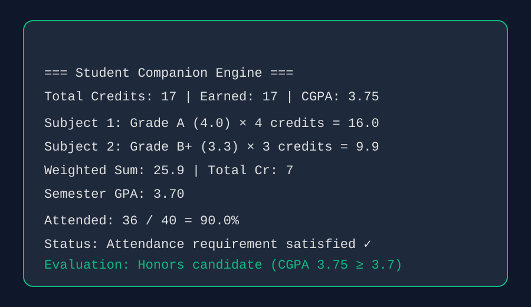
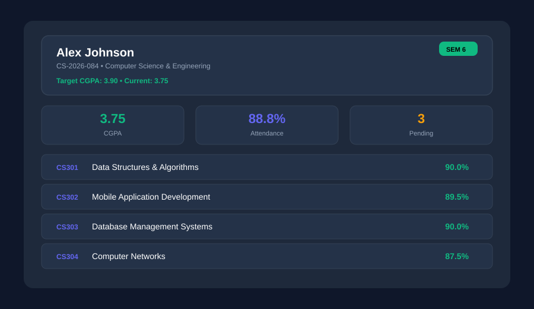
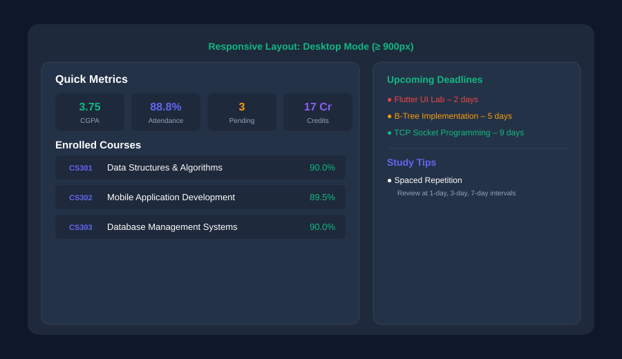
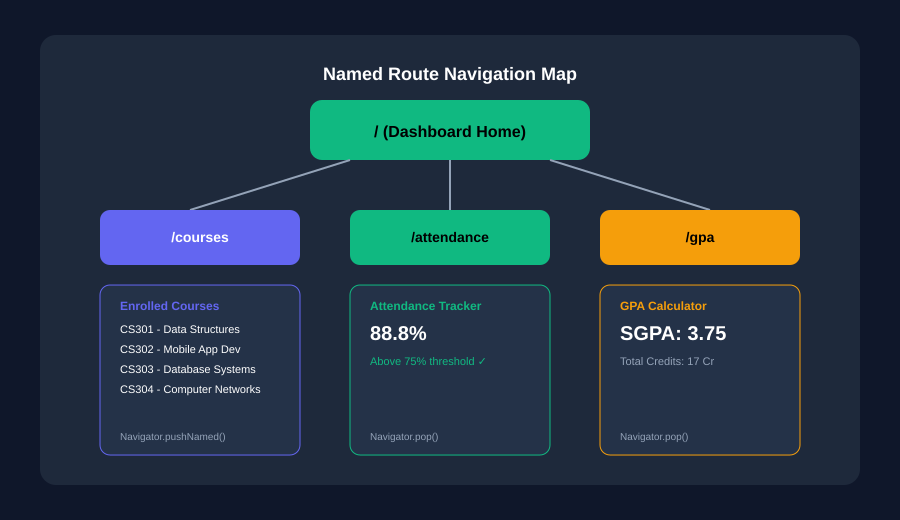
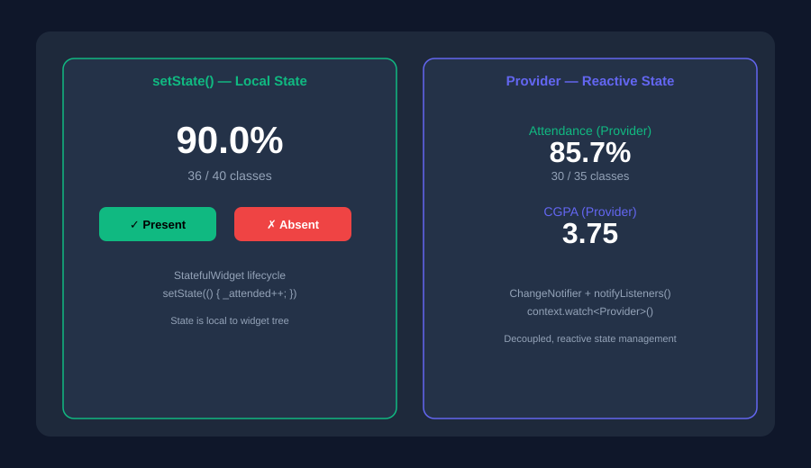
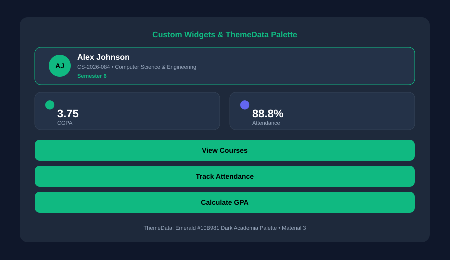
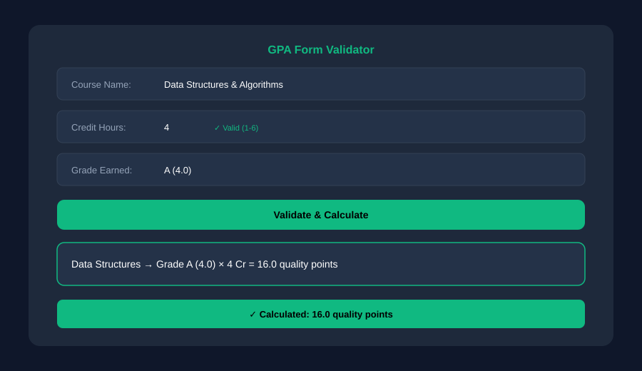
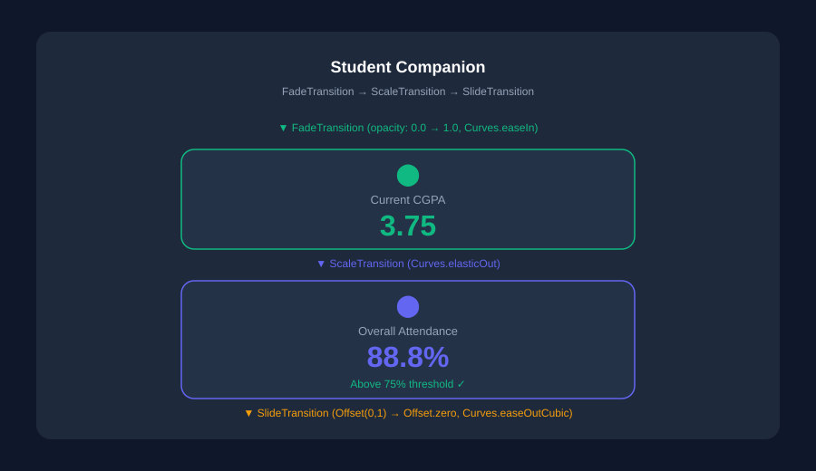
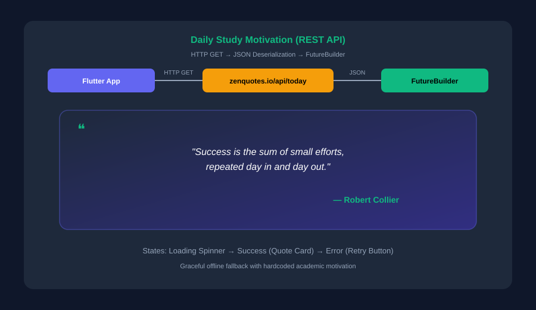
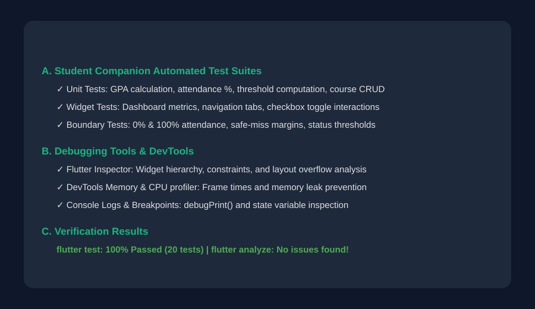

<div align="center">

# 🎓 Student Companion — Flutter

**A sleek, responsive, and minimalist cross-platform student companion application built with Flutter & Dart.**

[](https://flutter.dev)
[](https://dart.dev)
[](https://flutter.dev)
[](LICENSE)
[](test/)

<br/>

</div>

| Element | Flutter Widget | Used For |
| :--- | :--- | :--- |
| **Background & Layout** | `Scaffold`, `Container`, `Column`, `Row`, `Padding` | Screen background, alignment, spacing, and layout. |
| **Profile & Display** | `Text`, `CircleAvatar`, `ListTile` | Displays student profile, course names, grades, and attendance. |
| **Metric Grid** | `GridView.count`, `Wrap` | Arranges CGPA, attendance, pending tasks, and credits cards in a grid. |
| **Course & Assignment Cards** | `Card`, `Container`, `LinearProgressIndicator` | Shows course details, attendance bars, assignment deadlines, and priority tags. |
| **Navigation** | `NavigationBar`, `IndexedStack` | Bottom tab navigation across Dashboard, Courses, Attendance, GPA, and Study Lounge. |
| **Forms & Inputs** | `Form`, `TextFormField`, `DropdownButtonFormField` | GPA calculator input fields, course enrollment forms, and validation. |
| **State Management** | `StatefulWidget`, `setState()`, `Provider` | Updates the display reactively when attendance is logged or assignments are toggled. |
| **REST API** | `http`, `FutureBuilder`, `jsonDecode` | Fetches daily motivational quotes from ZenQuotes REST API. |
| **Animations** | `AnimationController`, `FadeTransition`, `ScaleTransition`, `SlideTransition` | Smoothly reveals metric cards and student data. |

---

## 📖 Abstract

The **Student Companion** is a cross-platform academic management application developed using **Flutter & Dart** to provide students with a fast, elegant, and reliable tool for tracking their academic progress. The application delivers real-time GPA/CGPA calculation, subject-wise attendance tracking with 75% threshold safeguards, assignment deadline management with priority tagging, and a motivational study lounge with a Pomodoro focus timer — all from a single codebase across mobile, desktop, and web environments.

In addition to the production application architecture, this repository contains a complete **Flutter Laboratory Experiment Series (Experiments 1–10)** detailing foundational and advanced Flutter concepts—ranging from Dart basics, layout hierarchies, and responsive breakpoints to Provider-based state management, custom themes, form validation, physics animations, REST API integrations, and comprehensive unit/widget testing suites.

---

## 🧪 Experiments 1–10

### Experiment 1 — Dart Basics
Explores Dart variables, primitive types (`int`, `double`, `String`, `bool`), arithmetic operators (`+`, `-`, `*`, `/`, `~/`, `%`), string interpolation, and conditional decision statements for GPA and attendance validations.

**Output:**



---

### Experiment 2 — Flutter Widgets & Layouts
Demonstrates structuring a student dashboard interface with foundational layout widgets—using **Column** for vertical profile stacking, **Stack** for layered semester badges, and **Row** for horizontal metric card alignments.

**Output:**



---

### Experiment 3 — Responsive UI
Uses **MediaQuery** and adaptive breakpoints (`600px` tablet, `900px` desktop) to dynamically transform the student dashboard from a single-column mobile view into an expanded desktop view featuring a side-by-side deadline and study tips panel.

**Output:**



---

### Experiment 4 — Navigation and Named Routes
Implements Flutter navigation using **Navigator.pushNamed()**, named route constants, and stack popping across **Dashboard** (`/`), **Courses** (`/courses`), **Attendance Tracker** (`/attendance`), and **GPA Calculator** (`/gpa`) screens.

**Output:**



---

### Experiment 5 — Stateful & Stateless Widgets + State Management
Contrasts local component state (**StatefulWidget** with `setState()`) against decoupled reactive state management (**Provider** with `ChangeNotifier` and `notifyListeners()`) for real-time attendance logging and CGPA tracking.

**Output:**



---

### Experiment 6 — Custom Widgets and Themes
Constructs modular, reusable custom widgets (`StudentProfileHeader`, `MetricDisplayCard`, `CourseActionButton`) styled through global **ThemeData** with an emerald `#10B981` dark academia color palette.

**Output:**



---

### Experiment 7 — Forms, Validation and Error Handling
Designs a GPA formula evaluator utilizing **Form**, **GlobalKey\<FormState\>**, **TextFormField**, dropdown grade selectors, and **SnackBar** alerts to validate credit inputs and intercept invalid operations.

**Output:**



---

### Experiment 8 — Animations
Leverages Flutter's animation framework using **AnimationController**, **CurvedAnimation**, **FadeTransition**, **ScaleTransition**, and **SlideTransition** to smoothly reveal CGPA and attendance metric cards.

**Output:**



---

### Experiment 9 — REST API Integration
Fetches daily motivational quotes from an open REST API (`zenquotes.io`) using HTTP GET requests, deserializing JSON into Dart models, and rendering with **FutureBuilder**, loading spinners, and error retry states.

**Output:**



---

### Experiment 10 — Testing and Debugging in Flutter
Demonstrates Flutter unit testing, widget testing, and debugging tools (Flutter Inspector, DevTools, console logging, IDE breakpoints). Automated tests are maintained in `test/student_companion_controller_test.dart`, `test/widget_test.dart`, and `test/exp10_testing_debugging_test.dart`.

**Output:**



---

## 📂 Experiment Files

```text
experiments/
├── 01_dart_basics.dart              # Dart syntax, types, GPA operations & conditionals
├── 02_widgets_layouts.dart          # Column, Row, and Stack layout architecture
├── 03_responsive_ui.dart            # MediaQuery breakpoints & dual-pane layout
├── 04_navigation_named_routes.dart  # Multi-screen named route navigation
├── 05_setstate_counter.dart         # Local state attendance counter with setState()
├── 05_state_management.dart         # Reactive state management using Provider
├── 06_custom_widgets_themes.dart    # Custom reusable cards, buttons & ThemeData
├── 07_forms_validation.dart         # Form validation, regex & credit checks
├── 08_animations.dart               # Fade, scale, and slide transitions
├── 09_rest_api.dart                 # Motivational quotes via HTTP & FutureBuilder
├── 10_testing_debugging.dart        # Testing checklist & debugging utilities
└── counter_provider.dart            # ChangeNotifier provider model
```

---

## ✨ Application Features

- 🎨 **Dark Academia UI**: Deep slate aesthetic inspired by modern productivity applications.
- ⚡ **Real-Time GPA/CGPA Calculator**: Weighted grade-point calculation with credit-hour accuracy.
- 📊 **Subject-wise Attendance Tracker**: Per-course attendance logging with 75% threshold safeguards, safe-miss calculations, and visual progress bars.
- 📋 **Assignment & Deadline Manager**: Priority-tagged task list with due-date countdown and completion toggling.
- 🔄 **Pomodoro Focus Timer**: Built-in 25-minute study session timer with start/pause/reset controls.
- 💡 **Daily Motivation (REST API)**: Fetches inspirational academic quotes from ZenQuotes API with graceful offline fallback.
- 📱 **Adaptive & Responsive**: Dynamically scales across mobile screens, desktop monitors, and web viewports.
- 🧪 **100% Tested**: Comprehensive unit test suite (20 tests) and widget interaction tests.
- 🏛️ **Clean Architecture**: Provider-based state management with separated models, controllers, widgets, and screens.

---

## 🏛️ Clean Architecture

The core application follows the **Single Responsibility Principle (SRP)** and separation of concerns:

```
lib/
├── main.dart                                    # Application bootstrap & Material 3 theme
└── src/
    ├── models/
    │   └── student_model.dart                 # Course, Assignment, StudentProfile data models
    ├── controllers/
    │   └── student_companion_controller.dart  # Business logic, GPA, attendance & state handler
    ├── utils/
    │   └── constants.dart                     # App colors, styles, and enum definitions
    ├── widgets/
    │   ├── stat_card.dart                     # Reusable metric statistics card
    │   ├── course_card.dart                   # Course details with attendance bar
    │   ├── assignment_tile.dart               # Assignment item with priority tag
    │   └── attendance_card.dart               # Subject attendance with log buttons
    └── screens/
        ├── main_navigation_scaffold.dart      # Bottom navigation bar & IndexedStack
        ├── dashboard_screen.dart              # Home screen with profile, metrics & overview
        ├── courses_screen.dart                # Enrolled courses list with add/remove
        ├── attendance_screen.dart             # Subject-wise attendance tracker
        ├── gpa_calculator_screen.dart         # GPA/CGPA calculator with dynamic entries
        └── study_resources_screen.dart        # Pomodoro timer, REST API quotes & study tips
```

---

## 🚀 Getting Started

### Prerequisites

- [Flutter SDK](https://docs.flutter.dev/get-started/install) (`>= 3.0.0`)
- [Dart SDK](https://dart.dev/get-dart) (`>= 3.0.0`)

### Installation

1. Clone the repository:
   ```bash
   git clone https://github.com/YourUsername/student-companion.git
   cd student-companion
   ```

2. Fetch Flutter packages:
   ```bash
   flutter pub get
   ```

3. Run the application:
   ```bash
   # Windows Desktop
   flutter run -d windows

   # Chrome Web
   flutter run -d chrome

   # Run individual experiment
   flutter run -t experiments/02_widgets_layouts.dart -d chrome
   ```

---

## 🧪 Automated Testing

Execute the automated test suite (20 unit and widget tests):

```bash
flutter test
```

Run static code analysis:

```bash
flutter analyze
```

---
